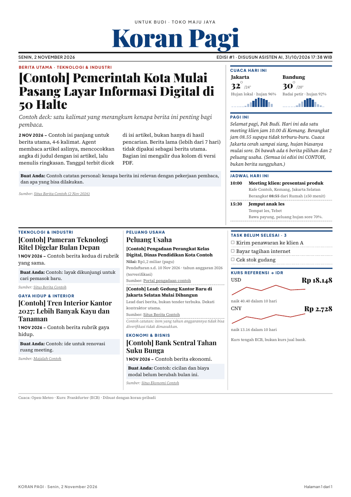

# Koran Pribadi

Koran harian **khusus untuk Anda**, disusun oleh agent AI setiap pagi dan sore:
jadwal hari ini, task, cuaca kota Anda, kurs, dan berita pilihan yang relevan dengan pekerjaan Anda.
Hasilnya satu halaman A4 bergaya surat kabar (PDF, siap cetak) plus versi web yang enak dibaca di HP.



## Cara kerja

```
agent AI ──► riset berita + baca kalender ──► edisi/2026-11-02.json
                                                     │
                                  koran.py  ◄────────┘   (+ cuaca Open-Meteo, kurs ECB: otomatis, tanpa API key)
                                     │
                     out/koran-pagi.html  +  out/koran-pagi-2026-11-02.pdf
```

- **Agent** bertugas sebagai redaksi: mencari berita, memverifikasi tanggal & angka, menulis ringkasan dan catatan "Buat Anda".
- **`koran.py`** bertugas sebagai percetakan: menyusun layout koran dan mengambil data live (cuaca, kurs).
- Pemisahan ini membuat layout selalu konsisten, dan agent cukup fokus ke isi.

## Fitur
- Masthead koran, berita utama 2 kolom, grid 3 kolom di bawah. Target 1 halaman A4.
- Edisi **pagi** (jadwal & cuaca hari ini) dan **sore** (jadwal & cuaca besok).
- Instalasi satu perintah + tanya-jawab pengaturan.
- Cuaca per jam untuk beberapa kota (Open-Meteo), kurs 10 hari dengan grafik kecil (Frankfurter / ECB).
- Rubrik, judul, kota, mata uang, dan susunan kolom diatur dari `config.json`.
- Daftar task dari JSON edisi, atau dari perintah apa pun yang mencetak satu task per baris (`task_command`).
- Versi web responsif: di HP jadi satu kolom dengan huruf besar.

## Instalasi (satu perintah)

Butuh Linux, macOS, atau Windows dengan WSL, plus Python 3.10+ dan git.

```bash
curl -fsSL https://raw.githubusercontent.com/saptoswa/personal-newspaper/main/install.sh | bash
```

Installer akan:
1. mengunduh repo ke `~/koran-pribadi`,
2. memasang WeasyPrint (untuk PDF) di lingkungan Python terpisah (`.venv`, tidak mengganggu sistem),
3. menanyakan beberapa hal tentang Anda (lihat tabel di bawah) dan mengisi `config.json`,
4. membuat koran contoh di `out/`.

Lebih suka manual? `git clone https://github.com/saptoswa/personal-newspaper.git koran-pribadi && cd koran-pribadi && bash install.sh`

> PDF butuh library Pango. Ubuntu/Debian: `sudo apt install libpango-1.0-0 libpangoft2-1.0-0` · macOS: `brew install pango`.
> Tanpa itu, versi web (HTML) tetap jalan.

## Yang perlu diisi

Installer menanyakan ini. Ubah lagi kapan saja dengan `./koran setup`, atau edit `config.json` langsung.

| Pertanyaan | Contoh jawaban | Dipakai untuk |
|---|---|---|
| Nama & panggilan | `Sari`, `Bu` | sapaan "Selamat pagi, Bu Sari" dan label "Buat Bu" di tiap berita |
| Pekerjaan / usaha | `guru SD`, `pemilik toko furnitur` | agent menulis kenapa sebuah berita penting buat Anda |
| Nama usaha (opsional) | `SD Harapan` | baris kecil di atas judul koran |
| Industri utama | `pendidikan`, `furnitur & interior` | rubrik pertama |
| Kata kunci industri | `kurikulum, sekolah digital` | arah riset berita agent |
| Topik kedua (opsional) | `properti`, `otomotif` | rubrik kedua |
| Peluang usaha/tender? | `y` + kata kunci `hibah sekolah` | rubrik tabel peluang (tender, pengadaan, lead proyek) |
| Ekonomi & Bisnis? | `Y` | rubrik ekonomi |
| Wilayah berita | `Indonesia` | agent mengutamakan berita wilayah ini |
| Kota cuaca 1–2 | `Depok`, `Bandung` | cuaca per jam (koordinat dicari otomatis) |
| Kurs | `USD, CNY` → `IDR` | kotak kurs + grafik 10 hari (kosongkan bila tidak perlu) |
| Google Tasks? | `y` | kotak "Task belum selesai" (setup sekali, lihat di bawah) |

Pengaturan lanjutan di `config.json`: `penyusun` (nama yang tertulis "Disusun ..."), `kolom` (isi 3 kolom bawah; `_task` dan `_kurs` = kotak bawaan), `zona_waktu`, `web_url`.

## Sinkron Google Tasks

Koran bisa menampilkan task yang belum selesai dari Google Tasks (**hanya baca**).
Setup sekali ±10 menit: buat kunci OAuth gratis di Google Cloud, lalu `google_tasks.py login`.
Panduan langkah demi langkah: [`docs/google-tasks.md`](docs/google-tasks.md).

Pakai aplikasi task lain? Isi `task_command` dengan perintah apa pun yang mencetak satu task per baris,
atau biarkan agent menulis `"task": [...]` di JSON edisi.

## Pakai dengan agent AI

1. Buka folder `~/koran-pribadi` dengan agent AI Anda (agent yang bisa membaca file, mencari di web, dan menjalankan perintah terminal).
2. Minta: **"Buatkan Koran Pagi hari ini, ikuti prompts/SOP-koran.md."**
3. Agent membaca profil Anda di `config.json`, riset berita, menulis `edisi/<tanggal>.json`, lalu menjalankan `./koran`.

Supaya tidak perlu menyebut SOP setiap kali, tambahkan kalimat itu ke file instruksi agent Anda.

### Jadwal otomatis
Contoh cron (pagi 06:00 dan sore 17:00) ada di [`docs/jadwal.md`](docs/jadwal.md).

## Struktur folder

```
koran-pribadi/
├── install.sh            # installer satu perintah
├── koran.py              # generator (layout + data live)
├── setup_wizard.py       # tanya-jawab pengaturan (./koran setup)
├── google_tasks.py       # ambil task Google Tasks (baca saja)
├── config.contoh.json    # contoh pengaturan (config.json Anda dibuat installer, tidak ikut git)
├── edisi/contoh.json     # contoh format edisi (semua isinya contoh)
├── prompts/SOP-koran.md  # instruksi redaksi untuk agent
├── docs/                 # gambar contoh & panduan jadwal
└── out/                  # hasil HTML & PDF (di-ignore git)
```

## Format JSON edisi (ringkas)

```json
{
  "tanggal": "2026-11-02", "edisi": 1, "jenis": "pagi",
  "sapaan": "Selamat pagi, ...",
  "agenda": [{"jam": "10:00", "judul": "...", "lokasi": "...", "berangkat": "08:55", "dari": "Rumah", "estimasi": "±50 menit"}],
  "task": ["..."],
  "utama": ["teknologi", 0],
  "berita": {
    "teknologi": [{"judul": "...", "tanggal": "...", "isi": "...", "relevansi": "...", "sumber": [["Media (tgl)", "https://..."]],
                   "deck": "(khusus berita utama)", "isi_panjang": "(khusus berita utama)"}],
    "peluang": [{"judul": "...", "nilai": "...", "status": "...", "sumber": [["...", "https://..."]]}],
    "peluang_catatan": "..."
  }
}
```

## Privasi
Edisi Anda berisi jadwal dan data pribadi. Folder `out/`, `.venv/`, dan file `edisi/*.json` (kecuali `contoh.json`) sudah di-ignore git, jadi tidak ikut ter-push. Kunci Google disimpan di `~/.config/koran-pribadi/`, di luar repo. `config.json` (nama & kota Anda) juga di-ignore; yang ikut repo hanya `config.contoh.json`.

## Lisensi
MIT. Font dari Google Fonts (Playfair Display, Source Serif 4, Plus Jakarta Sans, lisensi OFL). Data cuaca: [Open-Meteo](https://open-meteo.com) (CC BY 4.0). Data kurs: [Frankfurter](https://frankfurter.app) (kurs referensi ECB, bukan kurs jual bank).
